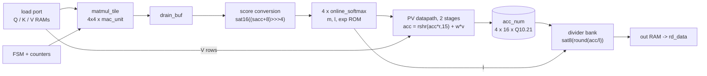

# p1-attention: a fixed-point streaming attention engine in SystemVerilog

[](https://github.com/saadafsy/p1-attention/actions/workflows/ci.yml)

One attention head (D = 16, N up to 64) in integer hardware. A 4x4 tile
computes Q.K^T, four online-softmax lanes keep a running max and
denominator per query row (the FlashAttention recurrence, so the N x N
score matrix is never stored), a 16-column datapath accumulates the
weighted V rows, and a divider bank produces the int8 (Q1.6) output.
Every result is bit-exact against a golden model.



## Results

| | |
|---|---|
| Accuracy | every output within 1 LSB of float64 attention; 93 to 98% exactly equal to the rounded float answer (scripts/accuracy.py) |
| Throughput | 19.9 MAC/cycle at N = 64 (62% of the 32 MAC units), 6593 cycles per inference |
| Timing, sky130 (pre-layout STA, 10 ns target) | whole engine about 94 MHz (-0.62 ns); online_softmax 100 MHz (+0.51 ns); MAC tile +3.4 ns |
| Place and route, sky130 (OpenROAD, 10 ns) | online_softmax 117.9 MHz and matmul_tile 142.2 MHz signoff, 0 DRC, 0 antenna, 0 slew/cap; whole engine with 4 OpenRAM SRAM macros (143k cells, 2.5 x 2.3 mm) closes at 12.6 ns (79.4 MHz) with 0 DRC and a clean power grid, limited by the macros' half-cycle read, see [pd/README.md](pd/README.md) |
| SRAM macros | macro-backed memory proven equivalent to the flop RAM in simulation (unit compare and the full engine suite, 11/11) |
| FPGA (Artix-7, synthesis only) | 84 DSP48, 6 RAMB18, about 8.7k LUTs: fits a Basys 3 |
| Verification | cocotb vs the golden model for every module, line + functional coverage gates, SymbiYosys proofs, gate-level simulation of the sky130 netlists, a UVM environment for the tile |

Details and caveats (what the STA does and does not model, I/O cost, how
each number is regenerated): [docs/benchmark.md](docs/benchmark.md).

Not done yet: nothing has run on a physical FPGA. The Vivado build for the
Basys 3 (fpga/scripts/build.tcl) and the UART host script are ready, and the
UART top passes its cocotb tests in simulation.

## Design points worth reading

- Numerics: six rounding sites and four saturation sites, every width
  derived ([docs/uarch.md](docs/uarch.md) sections 2 to 7).
- One exp lookup per element: m_new is either m or s, so one of the two
  LUT arguments is always 0 and a single subtractor gives the new max, the
  index and which output gets it (uarch 8.4, proven equivalent in formal).
- Timing work: what limited the clock at each step and what fixed it
  (uarch 8.4, docs/benchmark.md "History").

## Run it

Needs verilator, verible, cocotb 2.x, yosys and sby (OSS CAD Suite), plus
the sky130 liberty for the timing targets (`LIB=...`).

```
make model-check                       # golden models agree, LUT pinned
make verify MODULE=online_softmax      # lint, sim vs golden, coverage, synth check, formal
make verify MODULE=attention_top
make sta-top                           # whole-engine sky130 timing summary
bash pd/run_orfs.sh online_softmax     # place and route (Docker, openroad/orfs)
python3 scripts/accuracy.py            # accuracy vs float64 + throughput table
bash scripts/fpga_resources.sh         # Artix-7 resource count
```

## Repo map

```
rtl/       design: mac_unit, matmul_tile, online_softmax, exp_lut_1p, sync_ram, attention_top
model/     bit-exact golden model (Python and C++) and the exp LUT
tb/        cocotb testbenches per module, gate-level sim, UVM env, VHDL cross-check
formal/    SymbiYosys setups
pd/        OpenROAD place-and-route configs (blocks and the SRAM-macro engine)
fpga/      Basys 3 / Nexys A7 tops, UART protocol wrapper, host script, Vivado scripts
scripts/   gates (coverage, claim audit), STA flow, accuracy, resource count
docs/      uarch.md (spec), benchmark.md, guide.md (long walkthrough), design_rules.md
EVIDENCE.md  every result and the command that produced it
```
