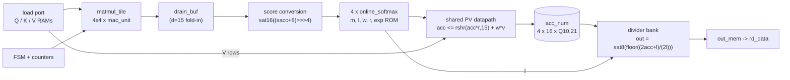

# p1-attention: a fixed-point streaming attention engine in SystemVerilog

[](https://github.com/saadafsy/p1-attention/actions/workflows/ci.yml)

A streaming attention accelerator for one head (D = 16, N <= 64): a 4x4
output-stationary tile computes Q.K^T (TPU-paper lineage), four online-
softmax lanes keep a running max and denominator per query row
(FlashAttention lineage) with a 1024-entry exp ROM, a shared 16-column
datapath accumulates the weighted V rows, and a restoring divider bank
produces the Q1.6 output. Everything is integer arithmetic with six
documented rounding sites and four saturation sites (docs/uarch.md), and
the whole design is checked bit for bit against a dual golden model
(Python and C++, cross-checked against each other) with cocotb, functional
and line coverage, lint, latch-free synthesis, bounded formal proofs,
sky130 synthesis with OpenSTA timing, gate-level simulation and a
switching-activity power proxy. Every claim in this repo traces to a row
in [EVIDENCE.md](EVIDENCE.md); rows that say a gate has not run yet mean
exactly that.



The full block, dataflow and timing diagrams are in
[docs/diagrams.md](docs/diagrams.md); the normative numeric and
microarchitecture spec is [docs/uarch.md](docs/uarch.md); the long-form
walkthrough is [docs/guide.md](docs/guide.md).

## Status

| Item | State | Evidence |
|------|-------|----------|
| Golden models (Python, C++) bit-identical, exp LUT sha256-pinned, float error gate met | PASS | [model-crosscheck] |
| mac_unit, matmul_tile: verify green (lint, cocotb vs golden, coverage, latch-free synth, BMC), dual auditor countersign | PASS; mac_unit TB seed fix awaits re-run | [verify-mac_unit], [verify-matmul_tile], audit rows |
| online_softmax: verify green, 52/52 functional bins, PIPE_ROM registered-ROM variant, dual re-audit | PASS; PIPE_ROM=1 now instantiates rtl/exp_lut_2p.sv, re-verify pending | [verify-online_softmax], [phase3-closure], audit rows |
| attention_top: end-to-end bit-exact, BRAM-pattern memories, dual countersign | PASS for the revision before 2026-09-18; shared-PV datapath, PIPE_ROM plumbing, depth-180 formal and new tests await re-run | [verify-attention_top], errata rows |
| Phase 4: sky130 STA (online_softmax 38.5 MHz naive, 76.9 MHz pipelined, tool estimates), GLS of both netlists 0 errors | PASS | [phase4-sta] |
| Phase 5: switching-activity power proxy, tradeoffs writeup | PASS | [phase5-docs] |
| Top-level STA of attention_top (`make sta-top`) | tooling written, never run | none yet |
| FPGA bring-up kit (UART protocol wrapper, host script): verified in cocotb simulation | sim PASS; protocol NAK hardening awaits re-run | [fpga-kit-sim], audit rows |
| FPGA on a Basys 3 (default) or Nexys A7-100T (XDCs, MMCM top, Vivado build/program/sweep scripts, XPM block-ROM exp tables) | written, never synthesized or run | PENDING-HARDWARE |
| UVM environment for matmul_tile (tb/uvm, Vivado xsim) | written, never compiled or run | none yet, see tb/uvm/README.md |
| VHDL port of mac_unit (rtl_vhdl/) with a same-vectors cross-check | written, never simulated | none yet |
| Perl ports of two scripts, byte-identical to the Python originals | PASS (`make perl-crosscheck`) | run on 2026-09-19 |
| GitHub Actions CI (pinned OSS CAD Suite, per-module `make verify`) | written, never observed green | badge above |
| Silicon (TinyTapeout) | PENDING-HARDWARE | none |

Bracketed ids are rows in [EVIDENCE.md](EVIDENCE.md), the append-only
ledger; the errata section at its end annotates the earlier rows a
2026-09-18 audit found overstated. Per PLAN.md, verified phases are
[Ready], not [Done]: the Done gate additionally requires the project
owner's replication pass. No FPGA, hardware-timing, bench-power or silicon
result exists; the design is verified in simulation and formal, synthesized
to latch-free netlists, not implemented on FPGA, not taped out.

## Run the regression in five minutes

Needs verilator, verible, cocotb 2.x, yosys and sby (+ yices) on PATH; the
OSS CAD Suite provides all but verible. Line endings are pinned to LF by
.gitattributes.

```
make verify MODULE=tool_smoke COVERAGE_STUB=1   # the toolchain gate
make model-check                                # golden models + LUT pin
make verify MODULE=mac_unit
make verify MODULE=matmul_tile
make verify MODULE=online_softmax
make verify MODULE=attention_top
make audit-guide                                # claim audit of the docs
```

Each `verify` runs lint, cocotb simulation against the golden model, the
coverage gate (line points with declared waivers, functional TOTAL), a
latch-free synthesis check and the SymbiYosys proof, and appends a
timestamped EVIDENCE.md row on success (`VERIFY_NO_LEDGER=1` for CI).
Everything else (`make sta-top`, `make gls`, `make -C tb/uvm gate`,
`make -C fpga hw-gate`, `make vhdl-crosscheck`, `make perl-crosscheck`)
is listed with its prerequisites in docs/guide.md section 12.

Toolchain paths: `LIB` (the sky130 liberty file) and `CELLS_SRC` in
tb/gls/Makefile (the PDK cell models) are machine-specific; the Phase 4
targets fail with a message if `LIB` is missing. Vivado is needed only for
tb/uvm and fpga/.

## Repo map

```
rtl/       SystemVerilog design: mac_unit, matmul_tile, online_softmax
           (PIPE_ROM parameter), exp_lut_2p (registered two-port ROM),
           attention_top (PIPE_ROM parameter), the generated exp_lut.svh.
rtl_vhdl/  mac_unit.vhd, the VHDL port, cross-checked on the same vectors.
model/     The bit-exact dual golden model and the normative exp_lut.hex.
tb/        cocotb testbenches per module, tb/gls (gate-level), tb/uvm (the
           UVM environment for matmul_tile), tb/vhdl_mac (VHDL/SV replay).
formal/    SymbiYosys .sby setups, one per module.
fpga/      Vendor-neutral bring-up kit (UART protocol wrapper, host script)
           plus the Artix-7 board top, Basys 3 / Nexys A7 XDCs, XPM exp
           ROM and Vivado scripts (BOARD=basys3 default).
scripts/   Gates and tools: check_coverage.py, audit_claims.py,
           evidence_snapshot.py, sta.tcl / sta_summary.py, power proxy,
           GLS vector generators (Python and Perl), vector exporters.
docs/      uarch.md (normative spec), guide.md, diagrams.md, benchmark.md,
           tradeoffs.md, verification_plan.md, the Phase 6/7 guides.
evidence/  Tracked snapshots of build/ reports cited by EVIDENCE rows.
process/   The build sheet, conversion notes, guide rubric and writer
           contract that shaped the project; CLAUDE.md holds the live rules.
```

## Further reading

- [docs/uarch.md](docs/uarch.md): if code and this file disagree, the code is the bug.
- [docs/guide.md](docs/guide.md): per-module walkthroughs, verification evidence, Phase 3 to 5 results, reproduction commands.
- [docs/benchmark.md](docs/benchmark.md), [docs/tradeoffs.md](docs/tradeoffs.md), [docs/verification_plan.md](docs/verification_plan.md).
- [docs/phase6_fpga_guide.md](docs/phase6_fpga_guide.md): the bring-up log template and the walkthrough; [docs/phase7_physical_guide.md](docs/phase7_physical_guide.md): OpenLane and TinyTapeout.
- [EVIDENCE.md](EVIDENCE.md): the claim ledger.
