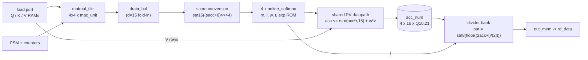

# p1-attention: a fixed-point streaming attention engine in SystemVerilog

[](https://github.com/saadafsy/p1-attention/actions/workflows/ci.yml)

One attention head (D = 16, N <= 64, int8 Q1.6 in and out). A 4x4 output-stationary
tile computes Q.K^T, four online-softmax lanes (running max and denominator,
1024-entry exp ROM) feed a shared 16-column PV datapath, and a restoring
divider bank produces the output. The RTL is checked bit for bit against a
Python and C++ golden model.



## Results

| What | Result |
|------|--------|
| Correctness | Bit-exact vs golden model in cocotb (two seeds), lint clean, latch-free synthesis, bounded formal proofs (details in [docs/guide.md](docs/guide.md)) |
| Accuracy vs float64 | mean 0.25 LSB, max 0.8 LSB of 2^-6 ([docs/metrics.md](docs/metrics.md)) |
| Throughput | 6593 cycles for N = 64, 19.9 MAC/cycle (41% of 48 multipliers) |
| Timing | online_softmax only: 38.5 MHz, or 76.9 MHz with the registered-ROM variant (sky130, OpenSTA estimates). No top-level Fmax. |

## Not done yet

- **Nothing has run on an FPGA.** The Basys 3 / Nexys A7 kit, UART host script and Vivado flow are written, not synthesized or run.
- **No top-level timing.** In standard-cell synthesis the attention_top memories become flip-flops, so top-level STA is not meaningful. The block-level MHz figures above came from an earlier toolchain and have not been reproduced on the newer one.
- **The CPU speedup is weak.** The baseline is the single-threaded C++ golden model, not an optimized kernel, and the gain shrinks as N grows ([docs/benchmark.md](docs/benchmark.md)). Prefer the MAC/cycle number.
- Scale is small (D = 16, N <= 64, 4x4 tile). The UVM environment, VHDL port and CI are also unrun.
- The earlier audit found a vacuous formal proof, a miscounting coverage gate and a wrong multiplier count; these are fixed and logged as errata in [EVIDENCE.md](EVIDENCE.md).

## Run it

Needs verilator, verible, cocotb 2.x, yosys and sby (the OSS CAD Suite covers all but verible).

```
make verify MODULE=tool_smoke COVERAGE_STUB=1   # toolchain gate
make model-check                                # golden models + LUT pin
make verify MODULE=attention_top                # lint, sim, coverage, synth, formal
python scripts/accuracy_report.py               # accuracy and MAC/cycle table
```

## Layout

`rtl/` design, `model/` golden models, `tb/` cocotb/GLS/UVM testbenches, `formal/` SymbiYosys,
`fpga/` board kit, `scripts/` gates and tools, `docs/` spec and guides. The full
per-item status table is in [docs/readme_full_status.md](docs/readme_full_status.md);
the spec is [docs/uarch.md](docs/uarch.md).
