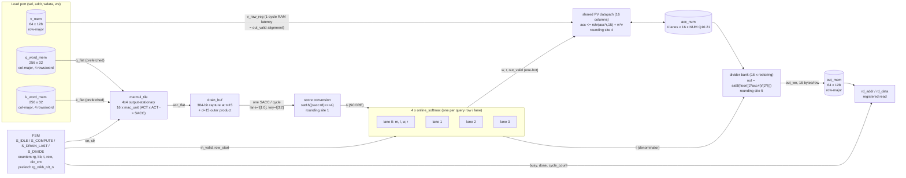
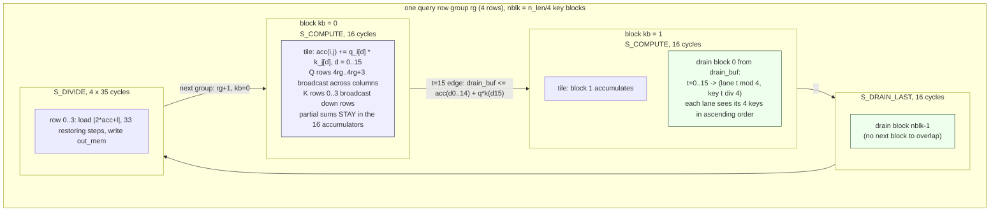

# Diagrams: block, dataflow, and the drain-overlaps-compute window

Added 2026-09-19. The Mermaid diagrams render directly on GitHub; the
WaveDrom timing diagram is kept as JSON source in docs/wavedrom/ and
rendered to docs/img/ by `make diagrams` (needs node: `npx wavedrom-cli`),
with an ASCII rendering below so the mechanism is readable without it.
Every signal name matches rtl/attention_top.sv.

## 1. Block diagram (attention_top, docs/uarch.md 8.3)



## 2. Dataflow: what streams, what stays put



Output-stationary in one sentence: the 16 partial sums never move
between PEs; Q and K elements stream past them for 16 cycles and the
finished block is read out in place (into drain_buf) on the last edge.

## 3. Timing: drain overlaps compute, and the d=15 fold-in

Window: cycles t=13, 14, 15 of block kb (kb >= 1, so block kb-1 is being
drained) and t=0, 1 of block kb+1. Values are as VISIBLE DURING the cycle
(after the edge that started it). Source: docs/wavedrom/drain_overlap.json.

```
cycle        | t=13 blk kb | t=14 blk kb | t=15 blk kb | t=0 blk kb+1 | t=1 blk kb+1
state        | S_COMPUTE   | S_COMPUTE   | S_COMPUTE   | S_COMPUTE    | S_COMPUTE
tile_en      | 1           | 1           | 1           | 1            | 1
tile_clr     | 0           | 0           | 0           | 1            | 0
q_flat/k_flat| d13 of kb   | d14 of kb   | d15 of kb   | d0 of kb+1   | d1 of kb+1
acc_flat     | kb: d0..12  | kb: d0..13  | kb: d0..14  | kb: d0..15   | kb+1: d0
drain_buf    | blk kb-1    | blk kb-1    | blk kb-1    | blk kb (new) | blk kb
             |             |             | ^ edge: drain_buf <= acc_flat(d0..14) + q_flat*k_flat(d15)
lane in_valid| lane 1      | lane 2      | lane 3      | lane 0       | lane 1
key_local    | 3           | 3           | 3           | 0            | 0
s (score)    | S[1][3] kb-1| S[2][3] kb-1| S[3][3] kb-1| S[0][0] kb   | S[1][0] kb
out_valid    | lane 0      | lane 1      | lane 2      | lane 3       | lane 0
             | (S[0][3])   | (S[1][3])   | (S[2][3])   | (S[3][3])    | (S[0][0] kb)
v_row_reg    | V row 4(kb-1)+3 for each out_valid above (read presented on the in_valid cycle)
```

The one subtlety: at the edge ending t=15, acc_flat is another module's
registered output and still holds d0..14 (its own d15 update lands on
that same edge). Rather than delay the whole drain schedule by a cycle,
drain_buf_next adds the d=15 product from the same cycle's q_flat/k_flat,
so the capture is the complete 16-term block and block kb starts draining
at t=0 with no dead cycle. During t=0 acc_flat briefly shows the complete
old block (d0..15) before clr replaces it with the new d0 on the next edge;
nothing reads it then, drain_buf is the source.

Row-start: the first drained element of a group (kb-1 = 0, key_local = 0,
t = lane) carries row_start into the lane's online_softmax and, one cycle
later through row_start_d, rebases that lane's acc_num bank to 0.
