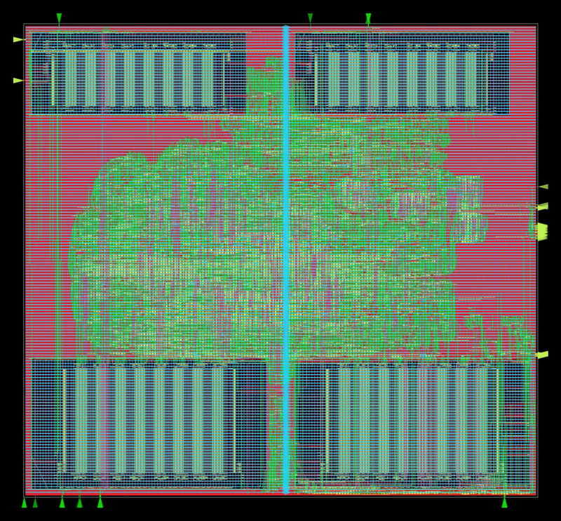

# Physical design (OpenROAD-flow-scripts, sky130hd)

`bash pd/run_orfs.sh <design>` runs RTL-to-GDS for one block in the
`openroad/orfs` Docker image:
- yosys synthesis;
- floorplan and power grid;
- placement and clock-tree synthesis;
- global and detailed routing;
- parasitic extraction;
- signoff STA;
- GDS.

The repo's `rtl/` and `pd/` are copied into the container, and results come
back to `build/orfs/<run>/`, with the numbers in
`reports/.../metadata.json`.

Environment variables:

| Variable | Use |
|---|---|
| `TARGET` | a single make target |
| `RUN` | result name |
| `ORFS_VARS` | extra make variables |
| `NUM_CORES` | how many cores the flow uses |
| `DOCKER` | path to the docker CLI |

All numbers are OpenROAD signoff values at the sky130 typical corner, after
routing and parasitic extraction. Power uses default switching activity.
Placed and routed in OpenROAD only: not taped out, no silicon measurement.
The reports are copied to `evidence/reports/20261109/`.

## Blocks (10 ns clock, 10% of the period as I/O delay on each side)

| Block | Signoff Fmax | Setup WNS | Hold WNS | Std cells | Die (um^2) | Power | DRC | Antenna | Slew / cap |
|---|---|---|---|---|---|---|---|---|---|
| online_softmax (PIPE_ROM=1) | 117.9 MHz | +1.52 ns | +0.49 ns | 3,657 | 60,167 | 1.92 mW | 0 | 0 | 0 / 0 |
| matmul_tile (4x4 MAC) | 142.2 MHz | +2.97 ns | +0.54 ns | 9,730 | 193,525 | 8.64 mW | 0 | 0 | 0 / 0 |

| online_softmax | matmul_tile |
|---|---|
|  |  |

The online_softmax configuration uses a 20% slew/cap repair margin. Without
it, routing left 12 slew and 1 cap violation of a few tens of ps.

## Whole engine with SRAM macros (attention_top)

The four memories become OpenRAM macros (docs/uarch.md 8.5):
- Q and K use `sky130_sram_1rw1r_64x256_8`;
- V and out use `sky130_sram_1rw1r_128x256_8`.

The macros are placed by hand in two rows (`pd/attention_top/`). Final run
of 2026-11-09, 12.5 ns constraint:

| Metric | Result |
|---|---|
| Cells | 143,522 std cells (0.99 mm^2) plus 4 macros (2.28 mm^2); die 2.5 x 2.3 mm |
| Detailed-route DRC errors | 0 |
| Antenna violations | 0 |
| Max slew / cap / fanout violations | 0 / 0 / 0 |
| Power grid | 0 shorts; all VDD and VSS shapes connected (check_power_grid) |
| Setup at 12.5 ns (the constraint) | WNS -0.017 ns, TNS -0.075 ns (worst path: K macro read data into s_conv) |
| Hold at 12.5 ns | +0.21 ns |
| Signoff STA of the same routed layout at 12.55 / 12.6 ns | setup +0.008 / +0.033 ns, hold +0.21 / +0.22 ns |
| Result | closes at 12.6 ns (79.4 MHz) |
| Power (tt, default activity, 12.5 ns) | 149 mW |
| GDS | written (`6_final.gds`) |

The last row reruns OpenSTA on the final netlist and extracted parasitics
(`6_final.odb` / `6_final.spef`) with only the clock period changed; nothing
is re-implemented. `evidence/reports/20261109/orfs_attention_top_final_*`
holds the reports.

### What it took

- **Macro LEFs.** In both macros, 130 or 258 vdd pads per column (two
  columns per macro) overlap gnd pads in the abstract. That gave 1,552 of
  the 1,566 shorts in the first run. `prepare.sh` runs `patch_sram_lef.py`
  in the container to move those pads to OBS.
- **Macro edge pads.** The power grid extended the outermost pads, within
  8 um of a macro's left or right side, outward to the core straps, across
  the other net's via stacks. That gave the last 14 shorts. The patch moves
  those pads to OBS too. Thousands of interior pads still connect each net
  (for example, 1,578 vdd and 1,410 gnd pads in the 64x256 macro).
- **Clock.** The macro liberty launches read data from the falling clock
  edge, so paths out of the macros get half a cycle. After global route the
  setup slack was -1.32 ns at 10 ns, -0.50 ns at 11.5 ns, and -0.02 ns at
  12.5 ns. Removing the half-cycle path needs an output register with one
  more cycle of read latency in attention_top, which is a verified RTL
  change and not done here. Clocking the read port on the inverted clock
  does not work: the vendor model blanks dout at the read clock's rising
  edge, and the equivalence tests failed.

The macro wrapper is proven equivalent to the flop RAM in simulation:
- `tb/sync_ram_sky130`: 2/2 at two seeds, about 39k cycles compared;
- `tb/attention_top_sram`: 11/11 on the macro models.
