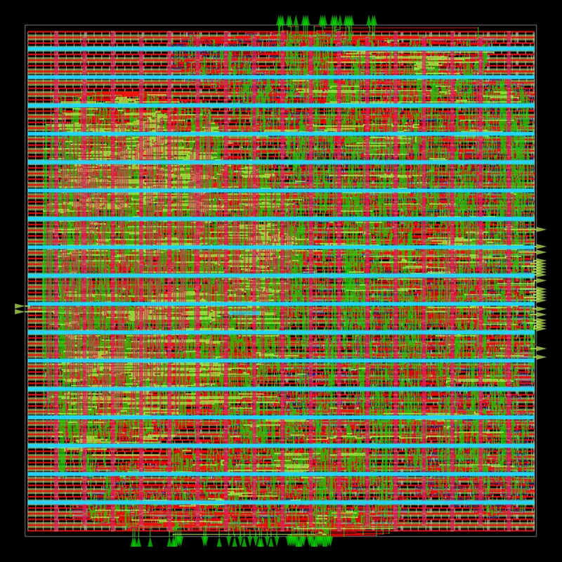
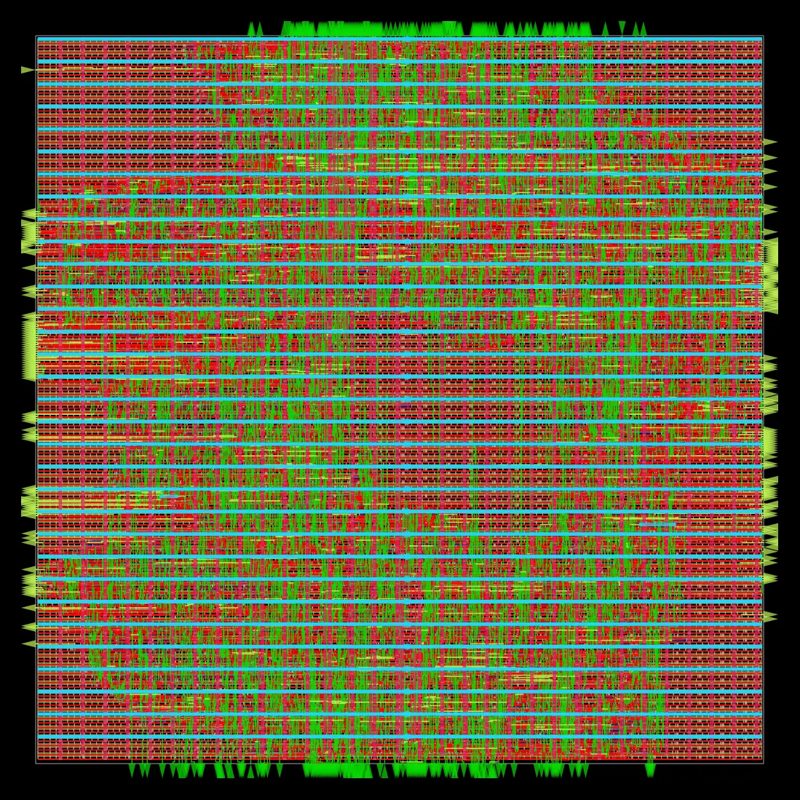

# Physical design (OpenROAD-flow-scripts, sky130hd)

`bash pd/run_orfs.sh <design>` runs RTL-to-GDS for one block in the
`openroad/orfs` Docker image:
- yosys synthesis;
- floorplan and power grid;
- placement and clock-tree synthesis;
- global and detailed routing;
- parasitic extraction;
- signoff STA;
- GDS.

The repo's `rtl/` and `pd/` are copied into the container, and results come
back to `build/orfs/<run>/`, with the numbers in
`reports/.../metadata.json`.

Environment variables:

| Variable | Use |
|---|---|
| `TARGET` | a single make target |
| `RUN` | result name |
| `ORFS_VARS` | extra make variables |
| `NUM_CORES` | how many cores the flow uses |
| `DOCKER` | path to the docker CLI |

All numbers are OpenROAD signoff values at the sky130 typical corner, after
routing and parasitic extraction. Power uses default switching activity.
Placed and routed in OpenROAD only: not taped out, no silicon measurement.
The reports are copied to `evidence/reports/20261109/`.

## Blocks (10 ns clock, 10% of the period as I/O delay on each side)

| Block | Signoff Fmax | Setup WNS | Hold WNS | Std cells | Die (um^2) | Power | DRC | Antenna | Slew / cap |
|---|---|---|---|---|---|---|---|---|---|
| online_softmax (PIPE_ROM=1) | 117.9 MHz | +1.52 ns | +0.49 ns | 3,657 | 60,167 | 1.92 mW | 0 | 0 | 0 / 0 |
| matmul_tile (4x4 MAC) | 142.2 MHz | +2.97 ns | +0.54 ns | 9,730 | 193,525 | 8.64 mW | 0 | 0 | 0 / 0 |

| online_softmax | matmul_tile |
|---|---|
|  |  |

The online_softmax configuration uses a 20% slew/cap repair margin. Without
it, routing left 12 slew and 1 cap violation of a few tens of ps.

## Whole engine with SRAM macros (attention_top): partial result

The four memories become OpenRAM macros (docs/uarch.md 8.5):
- Q and K use `sky130_sram_1rw1r_64x256_8`;
- V and out use `sky130_sram_1rw1r_128x256_8`.

The macros are placed by hand in two rows (`pd/attention_top/`). Run of
2026-11-09:

| Step | Result |
|---|---|
| Synthesis | 96,761 std cells, 0.87 mm^2, plus 4 macros (2.28 mm^2); die 2.5 x 2.3 mm |
| Placement, CTS, routing | complete, GDS written; 0 detailed-route DRC errors, 0 antenna violations |
| Setup timing | -1.32 ns at 10 ns after global routing (about 88 MHz) |
| Power-grid signoff | **fails**: 1,566 VDD shapes touch macro `gnd` terminals (IR-drop analysis stops with PSM-0069) |

Two problems remain:
- **Power grid.** The macro LEFs list two columns of met3 pads under both
  `vdd` and `gnd`, at x = 163.77/876.35 (64x256) and 214.22/926.80
  (128x256). The custom `pdn.tcl` places the macro straps to avoid them,
  but the straps still land on gnd pads. The power grid needs a strap
  layout derived from the LEF pad list, or patched macro LEFs.
- **Timing.** The macro liberty launches read data from the falling clock
  edge, so the paths from the macros into the MACs and `drain_buf` get
  about half a period. Registering the macro outputs, at one more cycle of
  read latency, would remove that, but it is an RTL change that needs a
  full re-verify.

The macro wrapper is proven equivalent to the flop RAM in simulation:
- `tb/sync_ram_sky130`: 2/2 at two seeds, about 39k cycles compared;
- `tb/attention_top_sram`: 11/11 on the macro models.
